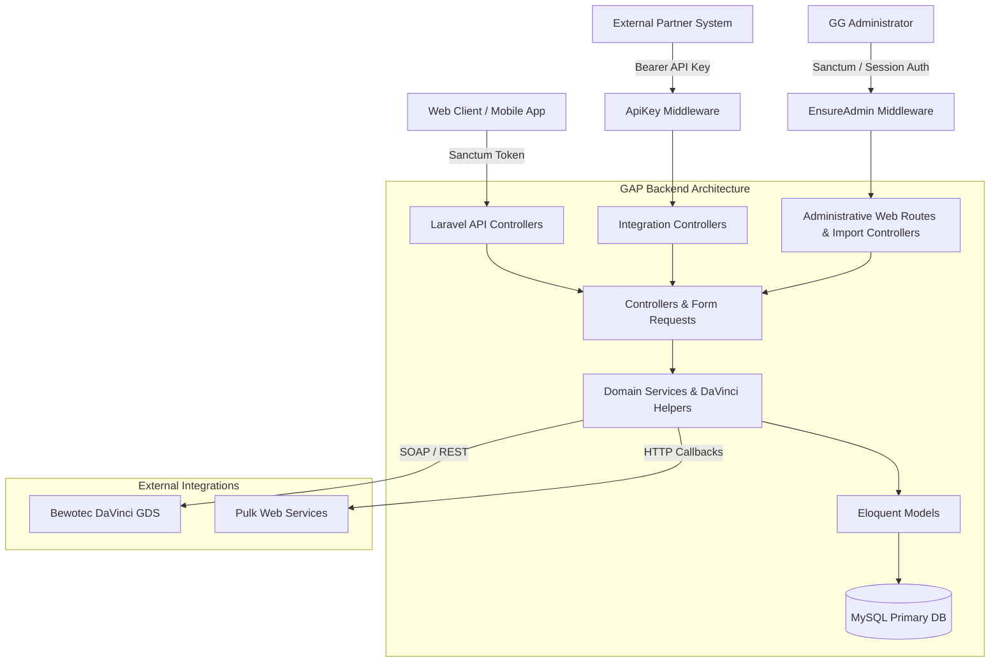

# GAP Backend (Golf & Agency Platform)

[](https://laravel.com)
[](https://php.net)
[]()

## 1. Project Overview & System Boundaries

GAP (Golf & Agency Platform) is a centralized B2B backend platform designed for managing golf travel packages, hotel availability, tee times, tour operators, travel agencies, and multi-tenant booking requests. It bridges internal inventory management with external partner integrations (such as Bewotec DaVinci GDS and partner web callbacks).

### System Boundaries
- **Core API (`/api/*`)**: Sanctum-authenticated JSON API for administrative operations, package configurations, hotel/golf course management, and booking workflows.
- **Partner Integrations (`/api/integrations/*`)**: API Key-protected endpoints for external travel agency and tour operator integrations.
- **Administrative Web Routes (`/davinci`, `/services`, `/facility`, `/show-log`, etc.)**: Guarded via `EnsureAdmin` middleware requiring authentic Golf Globe (GG) staff authentication and authorization.
- **DaVinci Syncing**: Background synchronization services with Bewotec DaVinci Cloud Services.

---

## 2. Technology Stack & Runtime Specifications

| Layer | Technology / Package | Constraint / Version |
| :--- | :--- | :--- |
| **Language** | PHP | `^7.3 \| ^8.0` |
| **Framework** | Laravel Framework | `^9.0` |
| **Authentication** | Laravel Sanctum & API Key & EnsureAdmin Middleware | `^2.11` |
| **Database** | MySQL / MariaDB (SQLite in-memory for Testing) | `MySQL 8.0+` |
| **Excel Export/Import** | Maatwebsite Excel | `^3.1` |
| **Activity Logging** | Spatie Laravel Activitylog | `^4.7` |
| **Backup Management** | Spatie Laravel Backup | `^8.1` |
| **Test Runner** | PHPUnit | `^9.3` |

---

## 3. Architecture Overview



### Module Breakdown
- **`App\Http\Controllers\Api`**: Handles user accounts, profile details, golf courses, hotels, rooms, requests, and enquiry workflows.
- **`App\Http\Middleware\ApiKey`**: Validates third-party integration API keys against active company permissions and expiration rules.
- **`App\Http\Middleware\EnsureAdmin`**: Enforces resource-level administrative authorization (requiring Golf Globe `CompanyType::GG` and non-client role).
- **`App\Http\Middleware\SanctumValidateToken`**: Manages personal access token validation and session lifetime tracking.
- **`App\Console\Commands\ResetRankCommand`**: CLI Artisan command (`gap:reset-rank`) for safe background image re-ranking.

---

## 4. Environment Configuration & Setup

### Prerequisites
- PHP `>= 8.0` with `pdo_mysql`, `mbstring`, `openssl`, `curl`, and `xml` extensions.
- Composer 2.x
- MySQL 8.0+

### Local Installation Steps

1. **Clone the Repository**
   ```bash
   git clone <repository-url>
   cd gap
   ```

2. **Configure Environment File**
   Copy the sanitized example template to create your local `.env`:
   ```bash
   cp .env.example .env
   ```

3. **Install Dependencies**
   ```bash
   composer install
   ```

4. **Generate Application Key**
   ```bash
   php artisan key:generate
   ```

5. **Run Migrations & Seeders**
   ```bash
   php artisan migrate
   ```

6. **Serve Locally**
   ```bash
   php artisan serve
   ```

---

## 5. Dependency Reproducibility & Lock Tracking

- **Tracked Lockfile**: `composer.lock` is tracked in version control to guarantee identical dependency versions across development, staging, and production environments.
- **Private Dependency Recommendation**: The `golfglobe/bewotec-api` dependency currently uses branch tracking (`dev-main`). For production stability, it is recommended to tag release versions (e.g. `v1.0.0`) or pin explicit commit hashes in `composer.json`.

---

## 6. Automated Testing & Verification

The test suite runs against an isolated SQLite in-memory database (`:memory:`) to prevent touching local or production data.

### Running Tests
Execute the full test suite (20 tests, 49 assertions):
```bash
./vendor/bin/phpunit
```

To run a specific test suite or class:
```bash
./vendor/bin/phpunit --filter AdminRouteSecurityTest
./vendor/bin/phpunit --filter ApiKeyMiddlewareTest
```

---

## 7. Security & Hardening Architecture

- **Administrative Route Protection**: All administrative endpoints (`/davinci`, `/services`, `/facility`, `/field`, `/room-field`, `/difficulty`, `/golf-style`, `/show-log`, `/get-log`, `/clear-log`, `/reset-rank`, `/pulk_publish`) are guarded under `auth:sanctum` and `admin` (`EnsureAdmin`) middleware.
- **State-Changing Operations**: Operations that mutate system state (`POST /clear-log`, `POST /reset-rank`) require explicit state-changing HTTP methods and emit structured audit log events.
- **CLI Maintenance**: Maintenance procedures like resetting image ranks are encapsulated in Artisan commands (`php artisan gap:reset-rank`).
- **Credential Isolation**: Production secrets and tracked credentials were untracked from Git. `composer.json` contains no embedded VCS credentials.
- **SQL Execution & Path Traversal**: Arbitrary SQL routes were deleted, and log endpoints strictly enforce filename sanitization (`basename` filtering and regex character restrictions).