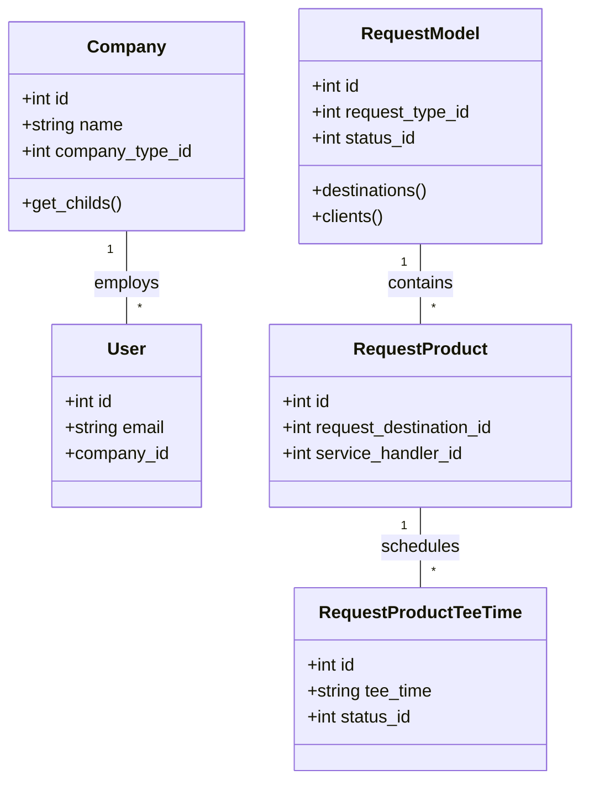

# Architecture & Design Specifications — GAP Backend

## Overview

GAP (Golf & Agency Platform) is built as a Laravel-based RESTful API service supporting B2B golf booking, product management, multi-tenant company relationships, and GDS synchronization.

## Domain Model Architecture

## Layer Responsibilities

1. **HTTP Layer (`app/Http`)**:
   - `Controllers\Api`: Process incoming JSON requests, invoke Eloquent queries or Helper services, and return JSON responses.
   - `Middleware`: Handles CORS headers, Sanctum session updates, and Integration API key verification.

2. **Domain & Integration Helpers (`app/Helper`)**:
   - `DaVinciHelper`: Integrates with Bewotec DaVinci SOAP/REST services for importing packages and pricing data.
   - `NotificationsHelper`: Handles email notifications and webhooks to partner systems.
   - `Helpers`: Shared utility methods for image upload, translation sync, and Pulk callbacks.

3. **Data Layer (`app/Models`)**:
   - Eloquent Models utilizing relationships (`belongsTo`, `hasMany`, `belongsToMany`), soft deletes, and activity logging.
